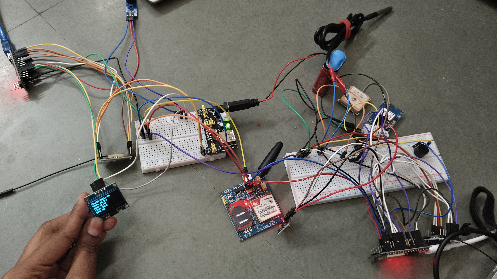

❄️ FROSTCAST – Intelligent Vaccine Box Monitoring and Warning System

  <b>Smart Temperature Monitoring | GPS Tracking | GSM Communication | Early Warning</b>

📌 Project Overview

FROSTCAST is an intelligent vaccine box monitoring and warning system designed to monitor vaccine storage conditions and detect abnormal temperature variations. By integrating temperature sensing, microcontroller-based processing, GPS tracking and GSM communication, the system aims to provide early warnings and support safer vaccine storage and transportation.

🚨 Problem Statement

Vaccines require specific temperature conditions to maintain their effectiveness. Temperature fluctuations during storage and transportation can affect vaccine quality and lead to vaccine wastage. Conventional monitoring methods may not provide continuous monitoring or timely alerts.

FROSTCAST addresses this challenge through an integrated monitoring and warning system.

💡 Proposed Solution

FROSTCAST continuously monitors the temperature inside the vaccine box using a temperature sensing module. The controller processes the readings and identifies abnormal temperature conditions.

The system integrates communication and location-tracking modules to support monitoring and warning functionality.

## 📸 Project Images
🔧 Hardware Prototype

  

  <b>FROSTCAST – Hardware Implementation</b>

  <b>FROSTCAST – Hardware Implementation</b>

⚙️ Hardware Components

- Microcontroller development boards
- Temperature sensing module
- OLED display
- SIM800L GSM/GPRS module
- GPS module
- Buzzer for warning alerts
- Breadboards and jumper wires
- Power supply circuitry

✨ Key Features

- Continuous temperature monitoring.
- Detection of abnormal temperature variations.
- OLED-based monitoring display.
- GSM communication integration.
- GPS-based location tracking.
- Buzzer-based warning mechanism.
- Designed for vaccine storage and transportation monitoring.

🔄 Working Principle

1. Temperature Sensing: The sensor measures the temperature inside the vaccine box.
2. Data Processing: The microcontroller receives and processes the temperature readings.
3. Condition Monitoring: The measured temperature is checked against predefined limits.
4. Warning Mechanism: An alert is activated when an abnormal temperature condition is detected.
5. Communication: GSM and GPS modules support communication and location-related functionality.

🏥 Applications

- Hospitals and healthcare centres.
- Vaccination centres.
- Pharmaceutical storage facilities.
- Rural healthcare facilities.
- Vaccine transportation and distribution.
- Medical cold-chain monitoring.

🚀 Future Scope

- Cloud-based temperature data logging.
- Mobile application integration.
- Real-time remote monitoring.
- SMS notifications to healthcare workers.
- Temperature history and report generation.
- Improved battery backup and power management.

🌍 Project Impact

FROSTCAST aims to improve vaccine storage safety by enabling continuous monitoring and early detection of temperature-related risks. It supports the goal of reducing vaccine wastage and improving reliability in vaccine transportation.

👩‍💻 Team Members

S.No| Team Member
1| Vybhavi R
2| Harshini M
3| Satveka A
4| Suruthi S

🛠️ Project Information

- Project Name: FROSTCAST
- Domain: Electronics and Communication Engineering
- Focus Areas: Embedded Systems, IoT and Healthcare Technology
- Project Type: Hardware-Based Monitoring System

---

  <b>❄️ FROSTCAST – Smarter Monitoring for Safer Vaccines.</b>

